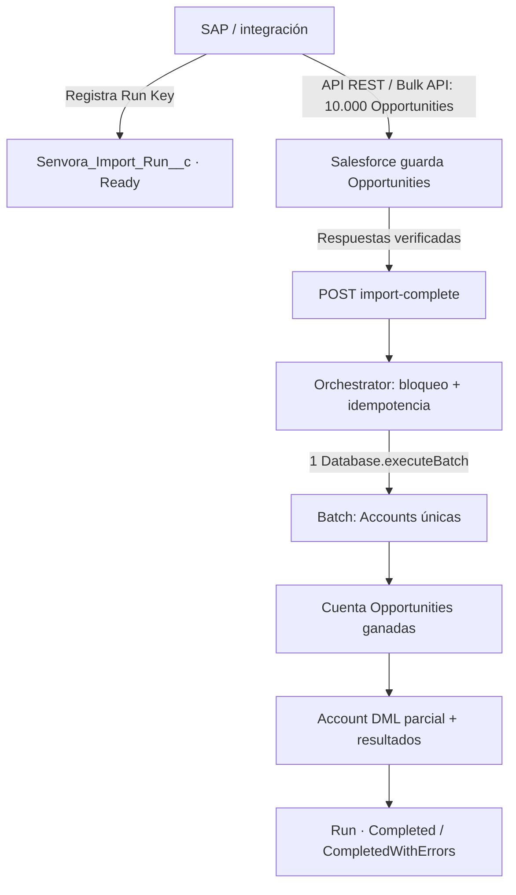

# SENVORA · Ejemplo Senior Salesforce: integración masiva + Batch Apex

Proyecto Salesforce DX **educativo y aislado**. Está pensado para abrirlo en Visual Studio Code, seguir el flujo línea por línea y practicar una entrevista técnica Senior Salesforce Developer.

> **No está conectado a SAP ni a una organización Salesforce real.** El código es un ejemplo desplegable en una sandbox/scratch org compatible con API 67.0, pendiente de compilar y ejecutar allí. No desplegar en producción sin adaptar permisos, límites y requisitos.

## 1. El requisito de negocio (sin suposiciones)

SAP modifica **10.000 `Opportunity`** a través de la API de Salesforce. Varias oportunidades pueden pertenecer a la misma cuenta. Una vez concluida y verificada la importación, debemos:

1. Identificar las **cuentas relacionadas con las oportunidades de esa carga**.
2. Calcular el número **total** de oportunidades ganadas (`Opportunity.IsWon = true`) de cada cuenta, incluidas oportunidades de importaciones anteriores.
3. Guardar el resultado en `Account.Senvora_Won_Opportunity_Count__c`.
4. Permitir que la importación de oportunidades permanezca confirmada **aunque falle posteriormente el recálculo** de una cuenta.
5. Evitar lanzar un Batch/Queueable por cada oportunidad o por cada grupo que dispare un trigger.
6. Evitar iniciar dos veces el trabajo si SAP reenvía la notificación de fin.

**Suposición explícita de esta demo:** las oportunidades importadas no cambian de `AccountId`. Si pueden trasladarse entre cuentas, también hay que incluir la **cuenta anterior** en el trabajo pendiente; véase «Límites de la demo».

## 2. Arquitectura



**¿Dónde está el trigger?** No hace falta uno para este requisito. Es deliberado. La integración marca las oportunidades con un identificador de carga y **el orquestador externo confirma el fin**, por lo que Salesforce no tiene que adivinar cuándo termina una importación. Un trigger que llamase a `Database.executeBatch` durante una carga masiva sería un antipatrón.

## 3. Los archivos que debes estudiar (en este orden)

| Archivo | Concepto de entrevista |
| --- | --- |
| `force-app/main/default/classes/SenvoraImportCompleteRest.cls` | Endpoint REST, JSON, validación y autorización |
| `force-app/main/default/classes/SenvoraImportOrchestrator.cls` | `FOR UPDATE`, idempotencia y **un solo** Batch por carga |
| `force-app/main/default/classes/SenvoraAccountRecalcBatch.cls` | `start`, `execute`, `finish`, QueryLocator y `Database.Stateful` |
| `force-app/main/default/classes/SenvoraAccountRecalcBatchTest.cls` | Prueba bulk de 200 Opportunities, cuentas repetidas y segunda llamada |
| `force-app/main/default/classes/SenvoraImportCompleteRestTest.cls` | Prueba de seguridad para el endpoint |
| `force-app/main/default/objects/` | Campos y objeto de control del proceso |
| `force-app/main/default/permissionsets/` | Permisos de la integración |

### ¿Por qué el Batch consulta Accounts y no 10.000 Opportunities?

Porque `start()` usa un **semi-join**:

```sql
SELECT Id
FROM Account
WHERE Id IN (
    SELECT AccountId
    FROM Opportunity
    WHERE Senvora_Import_Run_Key__c = :runKey
)
```

La consulta devuelve cada `Account` una sola vez. Si 10.000 oportunidades pertenecen a 300 cuentas, el Batch procesa **300 cuentas**, no 10.000 actualizaciones redundantes de Account. En `execute()` una consulta agregada `COUNT(Id) ... GROUP BY AccountId` calcula los totales de cada grupo.

### ¿Qué ocurre cuando falla una cuenta?

`Database.update(updates, false, AccessLevel.USER_MODE)` devuelve `SaveResult` por registro. Un Account fallido se cuenta y guarda una muestra del error, mientras que los Accounts correctos del mismo `execute()` pueden confirmarse. `Database.Stateful` mantiene los contadores entre ejecuciones. `finish()` marca la carga `Completed` o `CompletedWithErrors` y registra el ID de `AsyncApexJob`.

La importación de Opportunity ya se ejecutó en otras transacciones: **no hace rollback por un error posterior del Batch**.

## 4. Cómo abrirlo en Visual Studio Code

Desde la rama de ejemplo de GitHub:

```bash
git clone --branch example/salesforce-bulk-post-import https://github.com/senvorasystems/senvora-incident-api-demo.git
cd senvora-incident-api-demo/examples/salesforce-bulk-post-import
code .
```

Instala **Salesforce Extension Pack** y **Salesforce CLI** en tu equipo. Después, desde esta carpeta (la que contiene `sfdx-project.json`), autoriza una sandbox y revisa la fuente antes de desplegar:

```bash
sf org login web --alias senvora-training --instance-url https://test.salesforce.com
sf project deploy validate --source-dir force-app --target-org senvora-training --test-level RunLocalTests
```

Cuando la validación funcione y quieras practicar en la sandbox:

```bash
sf project deploy start --source-dir force-app --target-org senvora-training --test-level RunLocalTests
sf apex run test --tests SenvoraAccountRecalcBatchTest,SenvoraImportCompleteRestTest --target-org senvora-training --result-format human --wait 20
```

No se ha ejecutado esta validación contra una org: tendrás que hacerlo tú en tu sandbox.

## 5. Simular SAP con REST

En una sandbox, asigna el permission set `Senvora_Integration_Orchestrator` a un **usuario de integración dedicado** y comprueba que tenga acceso a las cuentas que debe actualizar. Las peticiones usan OAuth y permisos de clase Apex; el endpoint exige también la custom permission `Senvora_Complete_Import`.

1. **Registrar una carga** antes de importar (API estándar de objetos):

   `POST /services/data/v67.0/sobjects/Senvora_Import_Run__c`

   ```json
   {"Run_Key__c":"SAP-2026-11-12-001","Status__c":"Ready"}
   ```

2. **Actualizar las oportunidades**, mediante REST o Bulk API, indicando el mismo identificador en **cada Opportunity**:

   ```json
   {"StageName":"Closed Won","Senvora_Import_Run_Key__c":"SAP-2026-11-12-001"}
   ```

   El sistema externo debe comprobar las respuestas y registrar los registros fallidos. `Closed Won` es ilustrativo: usa un valor válido en tu organización.

3. **Avisar del fin**, solo cuando la integración haya terminado y verificado los resultados:

   `POST /services/apexrest/senvora/v1/import-complete`

   ```json
   {"runKey":"SAP-2026-11-12-001"}
   ```

   Primera llamada: HTTP **202**, estado `Queued`, `jobId`. Si repites la llamada, devuelve **200** con el estado y el mismo `jobId`; **no crea otro Batch**. Si no existe el registro de carga, HTTP **404**. Sin la custom permission, HTTP **403**.

Puedes probar las peticiones desde `scripts/rest-requests.http` con la extensión *REST Client* para VS Code; sustituye los valores de ejemplo por los de tu sandbox.

4. **Consultar el resultado**:

   ```sql
   SELECT Run_Key__c, Status__c, Batch_Job_Id__c,
          Updated_Accounts__c, Failed_Accounts__c,
          Failed_Scopes__c, Error_Samples__c
   FROM Senvora_Import_Run__c
   WHERE Run_Key__c = 'SAP-2026-11-12-001'
   ```

   Revisa también **Setup → Apex Jobs** y `AsyncApexJob` para ver excepciones de `start()`, `execute()` o `finish()`.

## 6. Pruebas incluidas

- **200 Opportunities** de la misma carga, distribuidas en 2 cuentas (190 + 10).
- Cálculo de oportunidades ganadas: **96** en la primera cuenta (95 importadas + 1 antigua) y **5** en la segunda.
- **Idempotencia:** dos llamadas a `complete(runKey)` producen **un solo** `AsyncApexJob`.
- Carga sin oportunidades: termina con **0** cuentas actualizadas.
- Carga inexistente: error controlado.
- Endpoint REST sin la custom permission: **403**.

## 7. Decisiones y límites de la demo

- **No garantiza inicio en segundos.** Batch entra en la cola asíncrona; su ejecución depende de recursos de Salesforce.
- **No ejecutar Batch desde triggers.** El sistema externo emite una señal de fin; alternativamente se podría usar un trabajo programado de reconciliación.
- **No hay reintentos automáticos.** Si hay errores de permisos, no servirá reintentar sin corregirlos. Para un re-proceso controlado, crea una nueva carga o implementa una transición manual auditada.
- **Cambios de AccountId:** esta demo busca las cuentas **actuales** de las oportunidades importadas. Si una oportunidad se mueve de cuenta, hay que registrar también la cuenta de origen, o ejecutar una reconciliación de ambas cuentas.
- **Concurrencia:** distintas cargas podrían afectar a una misma cuenta. En producción conviene serializar las ejecuciones que se solapan o rediseñar el mecanismo de consolidación.
- **Seguridad:** `USER_MODE` exige CRUD/FLS y acceso a registros. El permission set no sustituye las reglas de sharing. Ajusta el acceso del usuario de integración; no uses `SYSTEM_MODE` solo para evitar errores de permisos.
- **Estado atascado:** si `start()` falla antes de llegar a `finish()`, el estado puede permanecer en `Queued`. Monitoriza `AsyncApexJob` y configura alertas/reconciliación operativa.
- **Pruebas reales:** los tests incluidos prueban el comportamiento básico, pero **no simulan 10.000 filas ni colisiones concurrentes**. Prueba esas cargas en una sandbox representativa antes de producción.

## 8. Preguntas de entrevista (respóndelas revisando el código)

1. ¿Por qué `start()` devuelve Accounts con un semi-join, en lugar de las Opportunities importadas?
2. ¿Qué cambia si 10.000 oportunidades pertenecen a una sola cuenta?
3. ¿Cuántas transacciones ejecutaría Batch Apex con 300 Accounts y tamaño 100?
4. ¿Por qué `Database.update(..., false, AccessLevel.USER_MODE)` y no `update as system`?
5. ¿Para qué sirve `Database.Stateful`? ¿Qué problema no resuelve?
6. ¿Qué ocurriría si SAP llama dos veces al endpoint REST antes de que termine el Batch?
7. ¿Por qué una excepción de Batch no revierte la actualización original de Opportunity?

**Fuentes oficiales Salesforce:**

- [Batch Apex](https://developer.salesforce.com/docs/platform/apex-dev/references/apex-dev/apex-batch.html)
- [Asynchronous Apex](https://developer.salesforce.com/docs/platform/apex-dev/references/apex-dev/apex-async-overview.html)
- [Asynchronous Processing — Architecture](https://architect.salesforce.com/docs/architect/fundamentals/guide/async-fundamentals)
- [Set an Access Mode for Database Operations](https://developer.salesforce.com/docs/platform/apex-dev/references/apex-dev/apex-classes-enforce-usermode.html)
